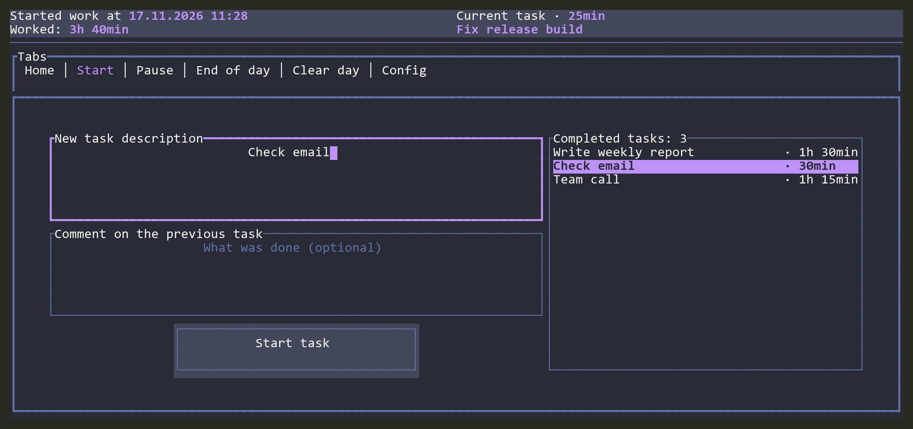
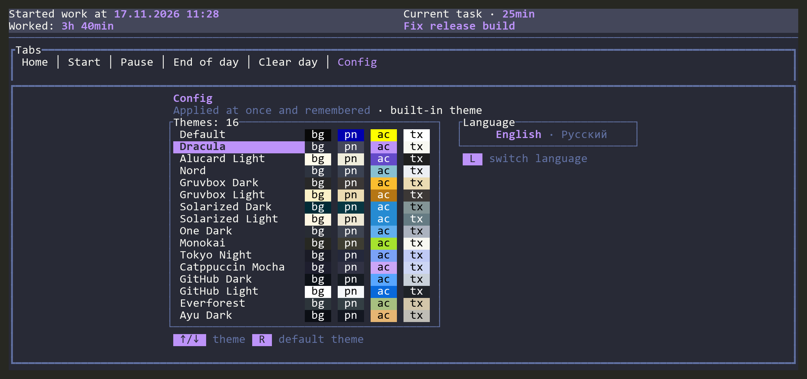

# sc-time-manager

Консольный трекер рабочего времени: задачи, длительности и выгрузка дня в `.xlsx`. Управление с клавиатуры; на Windows — один `.exe` без установки.



## Возможности

- Задачи и длительности, список выполненных задач за день.
- Выгрузка дня в `.xlsx`: формулы, итоговая строка, готовые значения.
- 16 встроенных тем и свои темы в папке `themes/`.
- Английский и русский интерфейс, переключение на вкладке `Config`.
- Безопасный сброс дня: подтверждение и копия `state.cleared-*.json`.
- Переносимая сборка: на Windows один `.exe` без Visual C++ Redistributable.

## Быстрый старт

```sh
git clone https://github.com/ncioo/sc-time-manager.git
cd sc-time-manager
cargo build --release
```

- **Windows:** `target\release\sc-time-manager.exe` — сборка, запуск и обход SmartScreen в [docs/windows.md](docs/windows.md).
- **macOS:** сборка и запуск — в [docs/macos.md](docs/macos.md).
- **Проверки:** `cargo test`, `cargo fmt --check`, `cargo clippy -- -D warnings`.

## Документация

| Документ | Содержание |
|---|---|
| [docs/windows.md](docs/windows.md) | сборка, запуск, окно, SmartScreen, подпись, перенос |
| [docs/macos.md](docs/macos.md) | сборка и запуск на macOS |
| [docs/usage.md](docs/usage.md) | вкладки, клавиши, жизненный цикл дня |
| [docs/config.md](docs/config.md) | `config.json`, выгрузка `.xlsx`, темы |

## Темы и язык



Тема выбирается на вкладке `Config` и сохраняется в `config.json`. Свои темы кладутся в папку `themes/` рядом с exe. Язык переключается клавишей `L` там же.

Подробнее: [docs/usage.md](docs/usage.md) и [docs/config.md](docs/config.md).

## Происхождение

Форк [igorslepenkov/time-manager](https://github.com/igorslepenkov/time-manager).
