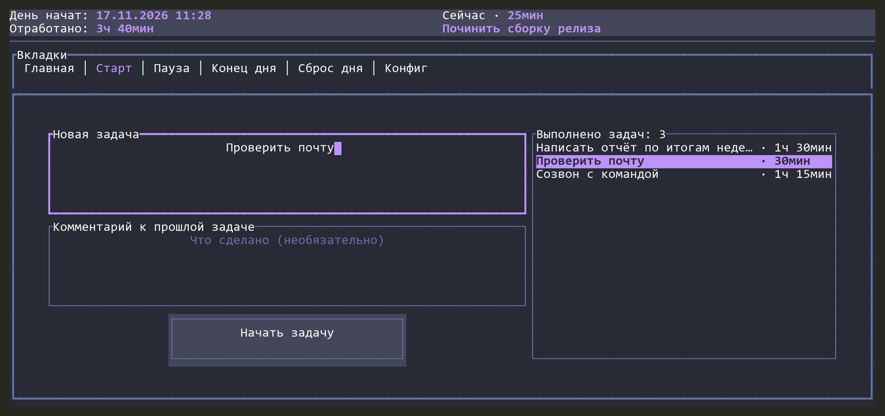
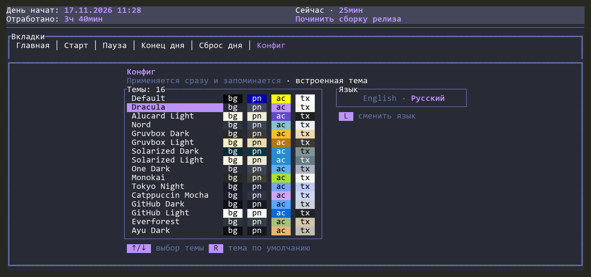

# Работа с приложением

## Вкладки

| Вкладка | Назначение |
|---|---|
| Home | приветствие, подсказки и предупреждения |
| Start | новая задача, комментарий, список выполненных |
| Pause | закрыть текущую задачу, оставив день открытым |
| End of day | итоги дня и выгрузка `.xlsx` |
| Clear day | сброс дня с подтверждением |
| Config | темы и язык |

`Tab` и `Shift+Tab` переключают вкладки по кругу, `Alt+1`…`Alt+6` открывают вкладку по номеру (кроме экрана «New day»).

## Клавиши

| Клавиши | Действие |
|---|---|
| `Tab`, `Shift+Tab` | следующая / предыдущая вкладка |
| `Alt+1`…`Alt+6` | вкладка по номеру |
| `↑`, `↓` | движение по списку или фокус между полями |
| `Enter` | отправить форму с любого поля |
| `Esc` | выход; при идущей задаче — дважды |
| `←`, `→`, `Home`, `End` | курсор в поле ввода |
| `Backspace`, `Delete` | удалить символ до / после курсора |
| `Ctrl+Backspace` | удалить слово |
| `Ctrl+V` | вставить из буфера обмена |
| `L` на Config | сменить язык |
| `R` на Config | вернуть тему `Default` |

## День

**Начало задачи.** На вкладке `Start` введите имя, при необходимости комментарий и нажмите `Enter`. Если задача уже идёт, она закроется, а новая начнётся.

**Список выполненных.** Справа на `Start` видны имя и длительность каждой задачи. `↑` в поле имени подставляет прошлую задачу и подсвечивает её строку.

**Пауза.** `Pause` закрывает текущую задачу и оставляет день открытым. Если активной задачи нет, приложение сообщит об этом.

**Конец дня.** `End of day` показывает, сколько задач и времени попадёт в файл, какая задача идёт сейчас и полный путь к `.xlsx`. `Enter` сохраняет файл, путь появляется в статусе.

**Сброс дня.** `Clear day` показывает, что именно будет удалено. Кнопка не в фокусе: спуститесь к ней `↓` и подтвердите. Перед сбросом день копируется в `state.cleared-<дата>.json`.

**Незакрытая смена.** Если приложение закрыли с идущей задачей, при следующем запуске появится экран «New day»:

- `Enter` — закрыть вчерашнюю задачу, выгрузить день и начать новый;
- `C` — продолжить вчерашний день;
- `Esc` — выйти ничего не меняя.

## Статус и ошибки

Внизу экрана — строка статуса: зелёная показывает успех, красная — ошибку. Ошибка не исчезает до следующего действия. Подробности дублируются в `sc-time-manager.log` рядом с `config.json`.

## Темы и язык

На вкладке `Config`: `↑` и `↓` листают темы, `L` переключает язык, `R` возвращает `Default`. Выбор сохраняется сразу.

Свои темы кладутся в папку `themes/` рядом с exe; формат и правила загрузки — в [config.md](config.md).
